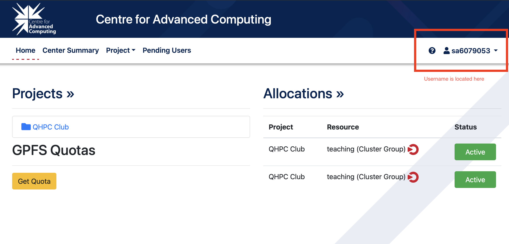

# Meeting 04: SSH and Slurm on the CAC

Connect to the CAC, use Vim to create a job script in `~/qhpc`, and submit it with Slurm.

## Prerequisites

- Complete the [SSH-key mini guide](../guides/ssh-keys.md) on your computer, or reuse an existing key.
- An active CAC account and your own CAC username.
- Use Bash on macOS, Linux, or WSL. On Windows, [install Git for Windows](../guides/git-on-windows.md) and open **Git Bash in Windows Terminal**.
- Basic terminal navigation and text editing with `vim`; see [Meeting 03](../03-linux-vms-and-containers/README.md#get-comfortable-in-a-terminal) if needed.

## 1. Configure SSH on your computer

SSH opens a terminal session on another computer. Find your username in the top-right corner of the CAC account portal:



On **your computer**, open `~/.ssh/config` in your preferred editor. For example:

**Bash (macOS / Linux / WSL / Git Bash):**

```bash
vim ~/.ssh/config
```

Keep existing entries and add the block below near the start. Replace `YOUR_CAC_USERNAME` with your username and adjust `IdentityFile` if you used another key filename.

```sshconfig
Host cac
    HostName login.cac.queensu.ca
    User YOUR_CAC_USERNAME
    IdentityFile ~/.ssh/id_ed25519
    IdentitiesOnly yes
    AddKeysToAgent yes
    IgnoreUnknown UseKeychain
    UseKeychain yes  # macOS only
```

`Host` is your shortcut; `HostName` and `User` identify the server and account. The key settings select your key and allow caching through a running SSH agent. `IgnoreUnknown` lets other platforms skip the macOS Keychain option.

Register your public key once. Run the appropriate commands **on your computer**, adjusting the `.pub` path if needed.

**Bash (macOS / Linux / WSL / Git Bash)**, with `ssh-copy-id` installed:

```bash
ssh-copy-id -i ~/.ssh/id_ed25519.pub cac
```

If `ssh-copy-id` is unavailable, use this Bash alternative:

```bash
cat ~/.ssh/id_ed25519.pub |
    ssh cac "umask 077; mkdir -p ~/.ssh; tr -d '\r' >> ~/.ssh/authorized_keys"
```

Connect using your shortcut:

```bash
ssh cac
```

On your first connection, confirm the host fingerprint using CAC guidance before accepting it. Follow the CAC authentication prompts; passwords and key passphrases do not appear as you type.

### Optional: reuse an authenticated connection

**macOS / Linux / WSL only.**

**Connection multiplexing** lets later `ssh cac` sessions from your computer reuse an existing connection without repeating the password and 2FA prompts. The first connection still authenticates normally.

Add these lines inside your existing `Host cac` block in `~/.ssh/config`:

```sshconfig
    ControlMaster auto
    ControlPath ~/.ssh/control-%C
    ControlPersist 1h
```

The shared connection stays available for up to one hour after the last session closes. If it disconnects or expires, the next connection authenticates again.

When finished, run `ssh -O exit cac` **on your computer** to close the shared connection and any attached sessions.

## 2. Create a job script on the CAC

After `ssh cac`, every platform uses the same Linux commands (bash) **on the CAC**, inside the SSH session:

```bash
# This is all bash now
mkdir -p ~/qhpc
cd ~/qhpc
vim hello.slurm
```

Vim is a terminal text editor. Press **i** to enter Insert mode, then paste (try typing it for fun :D):

*Use vimtutor if you need a refresher, or use this vim [cheat sheet](https://vim.rtorr.com).*

```bash
#!/bin/bash
#SBATCH --job-name=qhpc-hello
#SBATCH --ntasks=1
#SBATCH --time=00:01:00
#SBATCH --mem=256M
#SBATCH --output=hello-%j.out

echo "Hello from job $SLURM_JOB_ID"
hostname
date
```

Press **Esc**, type `:wq`, and press **Enter** to save and quit. To quit without saving, use `:q!` instead.

Slurm schedules work on compute nodes. The `#SBATCH` lines request one task, one minute, and 256 MiB of memory. `%j` becomes the job ID in the output filename. Account and partition use the CAC defaults.

## 3. Submit and inspect the job

From `~/qhpc` on the CAC:

```bash
sbatch hello.slurm
```

Expect `Submitted batch job` followed by a number. Use that number in place of `JOBID` below:

```bash
squeue -j JOBID
```

`PD` means pending; `R` means running. A short job may finish before you see it in the queue. After it finishes:

```bash
sacct -j JOBID --format=JobID,State,ExitCode,Elapsed
cat hello-JOBID.out
```

Look for `COMPLETED`, exit code `0:0`, and output containing your job ID, a compute-node hostname, and a date. Accounting results may take a moment to appear.

To cancel this job while pending or running, use `scancel JOBID`. Keep your script for later; remove its output with `rm hello-JOBID.out` when finished. Use `exit` to end the SSH session.

**Try next:** Change the greeting, submit again, and compare the two output files.

## Resources

- [CAC cluster information and documentation](https://cac.queensu.ca/systems/traditional-hpc/).
- [OpenSSH client configuration](https://man.openbsd.org/ssh_config): host settings, keys, and connection multiplexing; [SSH control commands](https://man.openbsd.org/ssh.1#O).
- [ssh-copy-id manual](https://github.com/openssh/openssh-portable/blob/master/contrib/ssh-copy-id.1): register your public key on a remote server.
- [Apple's SSH Keychain settings](https://developer.apple.com/library/archive/technotes/tn2449/_index.html): `UseKeychain` and `AddKeysToAgent`.
- [Vim: first steps](https://vimhelp.org/usr_02.txt.html): editing, saving, and quitting.
- [Slurm quick start](https://slurm.schedmd.com/quickstart.html); command references: [sbatch](https://slurm.schedmd.com/sbatch.html), [squeue](https://slurm.schedmd.com/squeue.html), [sacct](https://slurm.schedmd.com/sacct.html), and [scancel](https://slurm.schedmd.com/scancel.html).
