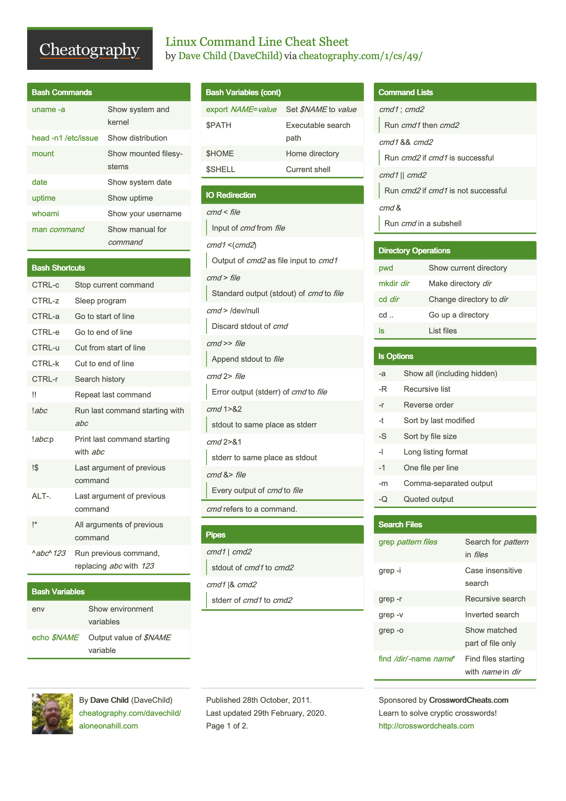
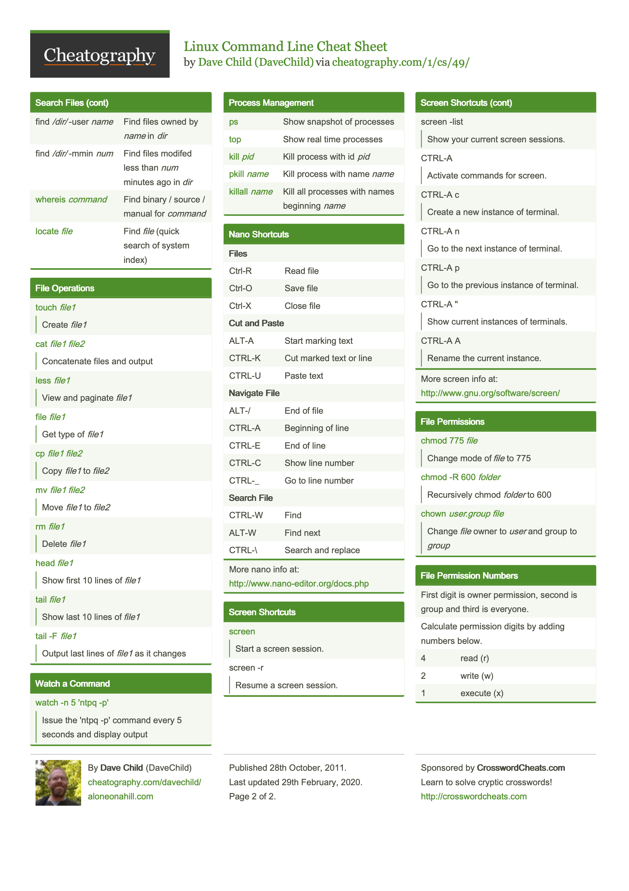

# Using the Linux CLI

Use the command-line interface (CLI) to navigate folders, work with files, and search text. The **terminal** is the app you type into; **Bash** is the shell that interprets your commands.

[Linux Cheat Sheet Section](#linux-cheat-sheet)

## Prerequisites

- **macOS:** Open **Terminal**. It defaults to [zsh](https://support.apple.com/guide/terminal/change-the-default-shell-trml113/mac), which accepts most Bash commands.
- **Linux:** Open your **Terminal** app.
- **Windows:** Open **Windows Terminal** with **WSL** or **Git Bash**.

Check that Bash and the tools used below are available:

**Bash (macOS / Linux / WSL / Git Bash):**

```bash
bash --version
command -v ls mkdir cat cp mv rm grep
```

Expect a Bash version and a path for each tool.

## What is a home directory?

Your **home directory** is your personal folder, usually `/home/your_username` on Linux. `~` is a shortcut to it; your terminal prompt may show `~` when you are there.

```bash
cd ~
pwd
```

`cd ~` takes you home, and `pwd` prints its full path (usually `/home/$USER`).

## Quick command reference

File and folder names are examples.

| Command | What it does |
| --- | --- |
| `pwd` | Show your current directory's full path. |
| `ls` | List files and folders. |
| `cd folder` / `cd ..` / `cd ~` | Enter a folder / go up one level / go home. |
| `mkdir folder` | Create a folder. |
| `cat notes.txt` | Show a text file's contents. |
| `cp notes.txt backup.txt` | Copy a file; `backup.txt` is the new copy |
| `mv backup.txt saved.txt` | Move or rename a file; `saved.txt` is the new name |
| `rm saved.txt` | Ask before deleting a file |

## Linux Cheat Sheet

A quick reference for common Linux commands.

[VIEW LINUX CHEAT SHEET (PDF)](resources/linux-command-line-cheat-sheet.pdf) — *Linux Command Line Cheat Sheet* by Dave Child (DaveChild), via [Cheatography](https://cheatography.com/1/cs/49/).

[](resources/linux-command-line-cheat-sheet.pdf)

[](resources/linux-command-line-cheat-sheet.pdf)

- [Ubuntu Linux Cheat Sheet](https://ubuntu.com/server/docs/reference/cli-cheatsheet/): Ubuntu's quick command reference; some commands are specific to Linux or Ubuntu.
- [LabEx Linux Cheat Sheet](https://linux-commands.labex.io): Another cheat sheet you may use.

## Useful: Pipes and grep

`grep` prints lines that match your search. Its a very useful tool when you need to parse large text output in the terminal. A pipe (`|`) passes one command's output into the next command.

Example:

```bash
# Displays preivous use of the cp command
history | grep cp 
# Prints preivous use of the sbatch command
history | grep sbatch 
```

**On the CAC**, after [connecting with SSH](../04-ssh-and-slurm/README.md#1-configure-ssh-to-the-cac) using your CAC account, run from any directory:

```bash
squeue -u "$USER" | grep -F "qhpc"
```

This lists your jobs, then keeps rows containing the literal text `qhpc`. Replace `qhpc` with part of the job name you want to find. No matching rows means no output.


## Resources

- [Ubuntu: the Linux command line for beginners](https://ubuntu.com/desktop/docs/en/latest/tutorial/the-linux-command-line-for-beginners/): a longer walkthrough.
- [GNU Bash manual](https://www.gnu.org/software/bash/manual/bash.html): shell commands, paths, redirection, and pipes.
- [GNU grep manual](https://www.gnu.org/software/grep/manual/grep.html): searching text.
- [Slurm squeue manual](https://slurm.schedmd.com/squeue.html): view queued jobs and filter by user or job ID.
- [YouTube: The 50 Most Popular Linux & Terminal Commands — freeCodeCamp.org / Colt Steele](https://www.youtube.com/watch?v=ZtqBQ68cfJc): an optional five-hour course; use its chapters to review a command when you need help.

[](https://www.youtube.com/watch?v=ZtqBQ68cfJc)
